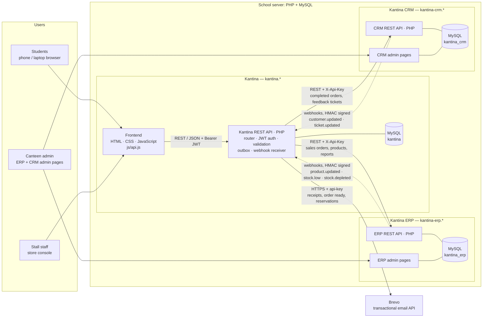
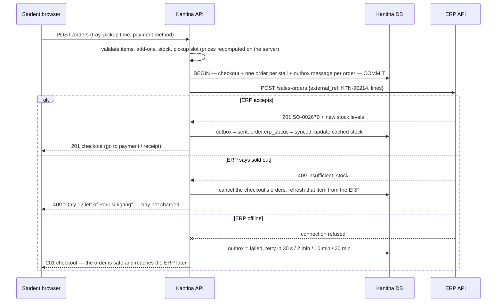
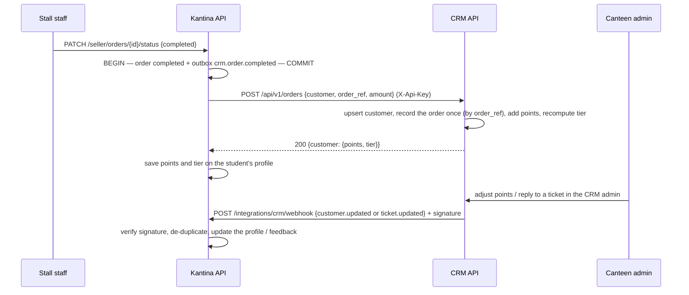

# Kantina — architecture and technology

Kantina is a campus canteen system for the Lawrence Bunzel Canteen, University of San Carlos.
Students pre-order from several stalls in one tray, choose a pickup time, pay (demo GCash or at the counter),
track their order live and reserve tables. Stall staff run orders, menus, tables and sales from a store console.

It is built as **three separate systems** that integrate over REST APIs and webhooks:

- **Kantina**: the student app, the store console and the main REST API
- **Kantina ERP**: inventory, prices and the sales ledger (Enterprise Resource Planning)
- **Kantina CRM**: customer records, order history, loyalty points and feedback tickets (Customer Relationship Management)

Each system has its own database and its own admin users, and can run on its own server.

---

## 1. System map



### Who owns which data

| Data | Owner | How the others get it |
|---|---|---|
| Users, accounts, roles | Kantina | — |
| Orders, order status, pickup slots | Kantina | ERP receives each order as a **sales order** |
| Tables, reservations, blocks | Kantina | — |
| Payments (demo GCash / counter) | Kantina | ERP receives *pay* / *cancel* |
| Stall profiles, hours, photos, menu names, descriptions, sections, add-ons, announcements | Kantina | edited in the store console |
| Price, stock, availability, SKU | **ERP** | Kantina keeps a copy, updated by ERP webhooks |
| Sales ledger, revenue, top items | **ERP** | Kantina's seller analytics call ERP reports |
| Customer records, purchase history, loyalty points and tier | **CRM** | Kantina sends each completed order; points/tier come back in the response and by CRM webhooks |
| Feedback and support tickets | **CRM** | Kantina sends each feedback message; replies come back by CRM webhook |

The **SKU** (e.g. `LS-TAPSILOG`) links a Kantina menu item to its ERP product. The **Kantina user id** links a student to their CRM customer record.

---

## 2. Integration flows

### 2.1 Placing an order (Kantina → ERP, transactional outbox)



- **Payment**: `POST /payments/{ref}/confirm` → orders become *paid* → outbox `erp.sales_order.pay` → ERP marks the sales order paid (it now counts as revenue).
- **Counter payment**: the stall presses **Accept** → same *pay* message.
- **Cancel** (student, stall or expired payment) → outbox `erp.sales_order.cancel` → ERP puts the stock back.
- ERP calls are **idempotent**: a repeated `POST /sales-orders` with the same `external_ref` returns the existing sales order, so retries never double-count.
- Messages for one order are delivered **in order** (create → pay → cancel).

### 2.2 Price and stock changes (ERP → Kantina, webhooks)

1. The canteen manager restocks or changes a price in the ERP admin. Or stock hits zero because of sales.
2. The ERP saves the change, then POSTs a signed webhook to `kantina/api/integrations/erp/webhook`:
   `product.updated`, `stock.low` or `stock.depleted`, with the full product.
3. Kantina verifies the HMAC signature, ignores duplicates (event id), and updates its copy of the price/stock.
4. Students immediately see the new price or "Sold out today". Failed deliveries can be resent from the ERP admin.

### 2.3 Customers and loyalty (Kantina → CRM, outbox + webhooks)

*Being built in #53 (CRM app) and #54 (Kantina side).*



- **Loyalty**: 1 point per ₱10 spent; Bronze below 100 points, Silver 100–299, Gold 300+.
- **Feedback**: `POST /feedback` saves the message in Kantina and sends `crm.ticket.create` through the outbox. The CRM creates a ticket (idempotent by Kantina's feedback id), and the admin's reply comes back as `ticket.updated`.
- The outbox means completed orders and feedback are never lost while the CRM is offline.

### 2.4 Store console menu edits (Kantina → ERP)

`PATCH /seller/menu/{sku}` splits the change:
- price, stock and availability go to `PATCH erp/api/v1/products/{sku}`
- name, description and section are saved in Kantina

New items (`POST /seller/menu`) are created in the ERP first (it generates the SKU) and then described in Kantina.
Products added directly in the ERP admin reach Kantina through the `product.updated` webhook and are listed under their ERP name.

### 2.5 Sales analytics (Kantina → ERP reports)

`GET /seller/analytics?range=7` calls `erp/api/v1/reports/sales` and `reports/top-items` for the staff member's stall.
Revenue includes both Kantina app orders and walk-in counter sales recorded in the ERP.

### 2.6 Email (Kantina → Brevo)

Order received, order ready and table reserved emails are sent through Brevo's transactional email REST API.
Every email is stored in the `notifications` table. Without an API key, the email is only logged.

---

## 3. Middleware and cross-cutting concerns

| Concern | How |
|---|---|
| Routing | Apache `.htaccess` rewrites `/api/*` to a front controller (`api/index.php`) → `Router` matches method + path |
| Authentication | Students and staff sign in → **JWT** (HS256, 7 days) → `Authorization: Bearer` header |
| Authorization | Role middleware: `Auth::student()`, `Auth::staff()`, `Auth::admin()`; staff see only their own stall |
| Validation | `Validator` checks every input; errors return `422` with per-field messages |
| Errors | One JSON error format `{error: {code, message, fields}}` with proper HTTP status codes |
| Logging | Every request is logged (`request_log`: method, path, status, user, time taken) |
| Brute force | 5 wrong passwords lock that login for 10 minutes (`429`) |
| System-to-system auth | `X-Api-Key` header on ERP/CRM APIs |
| Webhook security | HMAC-SHA256 signature with timestamp (`X-Kantina-Signature`), 5-minute replay window |
| Reliability | Transactional outbox with retries and backoff; idempotent ERP/CRM endpoints; webhook de-duplication |
| Consistency | Database transactions; row locks for table bookings and stock changes |
| Passwords | `password_hash` / `password_verify` (bcrypt) |
| Admin pages | PHP sessions, CSRF tokens on every form, output escaping |

---

## 4. Technology stack

| Layer | Technology | Why we used it |
|---|---|---|
| Frontend | **HTML5, CSS3, vanilla JavaScript** (`fetch`, `localStorage`) | Lightweight pages that load fast on phones; no build step, so every member can edit them |
| Frontend ↔ API | **REST + JSON**, `js/api.js` helper | One place for the base URL, tokens, errors and the cart |
| Backend / API | **PHP 8** (no framework): front controller, router, middleware | Runs on XAMPP and on the school's PHP hosting with nothing to install |
| Database | **MySQL / MariaDB** (three databases: `kantina`, `kantina_erp`, `kantina_crm`) | Relational data (orders, stock, ledger) with transactions and row locking; each system owns its own data |
| Data access | **PDO** with prepared statements | Protects against SQL injection |
| ERP integration | **Kantina ERP** REST API + signed webhooks | Inventory and the sales ledger live in the ERP, not in the ordering app |
| CRM integration | **Kantina CRM** REST API + signed webhooks | Customer history, loyalty and feedback live in the CRM, not in the ordering app |
| Authentication | **JWT** (HS256), bcrypt passwords | Stateless API sessions for the student app and console |
| Integration security | API keys, **HMAC-SHA256** webhook signatures | Systems trust only each other |
| Email (third-party cloud API) | **Brevo transactional email API** | Order and reservation emails over HTTPS; free tier |
| Payments | Simulated GCash step (PayMongo test mode as a stretch goal) | Shows the payment flow without real money |
| API documentation | **OpenAPI 3** + Swagger UI (`kantina/api/docs/`) | Interactive docs to try every endpoint |
| Hosting | **School server** PHP subdomains + MySQL; Apache `.htaccess` | One subdomain per system |
| Dev tools | XAMPP, PHP built-in server (`dev.sh`), Git + GitHub (issues, pull requests, milestones), VS Code | Team workflow and local testing |

---

## 5. Databases

| Database | Main tables |
|---|---|
| `kantina` | `users`, `stalls`*, `menu_items`*, `announcements`*, `favourites`, `checkouts`, `orders`, `order_items`, `dining_tables`, `reservations`, `table_blocks`, `integration_outbox`, `webhook_log`, `notifications`, `request_log`, `kv_store` (* = price/stock copied from the ERP) |
| `kantina_erp` | `erp_stalls`, `erp_products`, `erp_stock_movements`, `erp_sales_orders`, `erp_sales_order_lines`, `erp_webhook_deliveries`, `erp_admins` |
| `kantina_crm` | `crm_customers`, `crm_interactions`, `crm_tickets` (#53), `crm_webhook_deliveries`, `crm_admins` |

Schemas and demo data: `database/*.sql`.

---

## 6. Deployment layout

```
kantina.<school-domain>       → kantina/   (student app, seller/, api/, api/docs/)
kantina-erp.<school-domain>   → erp/       (api/, admin/)
kantina-crm.<school-domain>   → crm/       (api/, admin/)
MySQL: kantina, kantina_erp, kantina_crm
```
If only one subdomain is available, the three folders can sit side by side under it (`/kantina`, `/erp`, `/crm`).
See the README, section **Deployment**.
